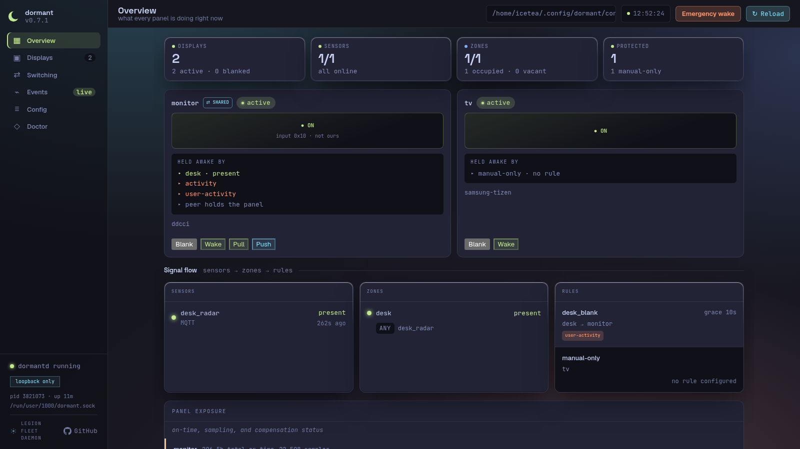
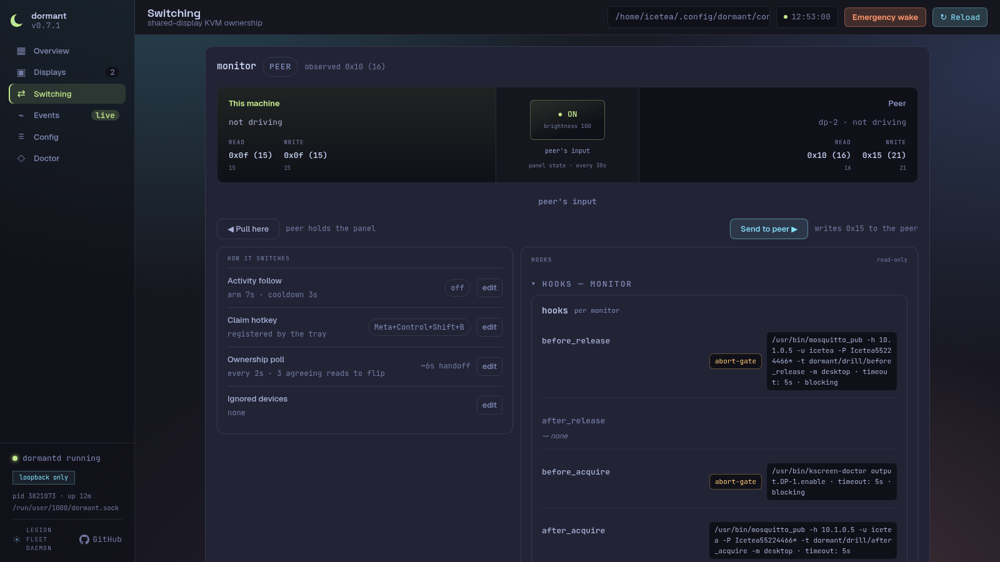
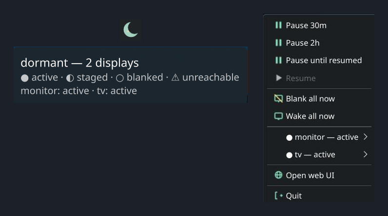

<p align="center">
  
</p>

<p align="center">
  <strong>Blank OLED screens when the room empties. Wake them the moment you return.</strong>
</p>

<p align="center">
  <a href="https://github.com/legion-works/dormant/actions/workflows/ci.yml"></a>
  
  
  
  <a href="https://github.com/legion-works/dormant/releases/latest"></a>
</p>

---

OLED panels burn in when they hold a static image. OS idle timers are a blunt fix — they blank while you're reading and linger after you leave. Presence sensors know the difference: they can tell an empty room from a still one.

`dormant` is a Rust daemon that reads those sensors and blanks your displays only when the room is actually empty, then wakes them the instant someone walks back in. It runs your PC monitors and your TVs, over local buses and over the network, on rules you write per display.

## What it does

- Blank displays when a room is empty instead of on a fixed idle timer — driven by MQTT, Home Assistant WebSocket, or USB mmWave radar sensors
- Blank without killing audio — DDC/CI, Samsung Tizen, and gamma-table paths leave the OS output intact
- **Soft KVM** — two machines, one monitor; pull the panel by hotkey, CLI, tray, or web.
- On Linux Wayland, use a configurable render ladder with a muted mpv screensaver, a black overlay, and hardware power-off.
- Track brightness-weighted panel on-hours per display, stored locally — no telemetry
- **Wear-even screensavers** — order media and bias bounded pixel shifts toward cooler estimated panel regions
- **Active wear sampling** — opt in to content-weighted OLED wear tracking from the KDE Wayland compositor.
- **Source-gated TV wear sampling** — attribute HDMI-connected Samsung TV wear from local frames only while the TV is showing that input.
- Configure and control through a web dashboard that defaults to loopback and preserves config comments.
- **Config section rail** — sticky per-tab section navigation with scroll-spy in the web UI
- Edit coordination, keymaps, input filters, and hooks in the web UI. The dashboard shows switch feedback, event history across reloads, doctor checks, and panel wear.
- Drive the daemon from a desktop tray with global hotkeys (Linux KDE · macOS menu bar)
- Probe every sensor and display against live hardware with `dormantctl doctor`
- Recover from a bad config boot: automatic last-known-good rollback, a systemd watchdog, and `dormantctl emergency-wake`
- **MQTT state publishing** — opt-in retained state + Home Assistant discovery for sensors, zones, and displays

<p align="center">
  
</p>

<p align="center">
  
</p>

<p align="center">
  
</p>

## Why not just DPMS?

Protecting OLEDs *without* the usual trade-offs — no black bars burned into the panel, no audio cutting out when the TV screen goes dark, no three-second wait to see your desktop again. Every blank mode makes a different bargain:

| Mode | OLED protection | Audio survives | Wake |
|---|---|---|---|
| `screen_off_audio_on` | Full | Yes | Fast |
| `power_off` | Full | Depends on controller and display | Depends on display |
| `brightness_zero` | Partial — pixels stay lit | Yes | Instant |

These display paths leave the OS output enabled:

- **`ddcci` `power_off`** writes VCP `0xD6` straight to the monitor's internal controller. The panel blanks; the OS output — and its audio sink — stay up.
- **`samsung-tizen` `screen_off_audio_on`** sends `KEY_PICTURE_OFF` over WebSocket. The TV cuts its backlight; the HDMI source keeps running and the audio plays on.
- **`samsung-tizen` `brightness_zero`** sets the backlight to zero through Samsung IP Control G2 on port 1516. Use it if `KEY_PICTURE_OFF` interrupts the source or audio.
- **`macos-gamma-black`** sets the macOS gamma table to black without changing the display power state.

Every DPMS path (`kwin-dpms` included) tears the output down and takes the audio with it, which is why it's a documented fallback, not a default.

## What's in the box

Three binaries: **`dormantd`** (the daemon), **`dormantctl`** (the CLI), and **`dormant-tray`** (a desktop tray applet).

### Sensors

| Source | |
|---|---|
| MQTT — Zigbee2MQTT, ESPHome, any broker (auth supported) | Ready |
| Home Assistant WebSocket | Ready |
| USB-serial LD2410 mmWave radar | Ready |

Zones combine sensor states with `any`, `all`, `quorum`, or `weighted` logic. A sensor that stops reporting is unavailable. The default zone policy treats unavailable sensors as present.

`dormantctl doctor` checks the configured sensors and displays. `--report-issue`
and `--draft-feature` turn the full offline probe run into a ready-to-file
GitHub issue draft, with known config and credential values redacted.

### Display controllers

| Controller | |
|---|---|
| `ddcci`: DDC/CI power-off and brightness (audio-safe, Linux, macOS, and Windows) | Ready |
| `samsung-tizen` — Samsung Tizen TVs over WebSocket | Ready |
| `kwin-dpms` — KDE Wayland DPMS (audio-unsafe fallback, Linux only) | Ready |
| `ha-passthrough` — any Home Assistant service call | Ready |
| `command` — arbitrary blank/wake shell commands | Ready |
| `macos-gamma-black` — Quartz gamma-table black (audio-safe, macOS only) | Ready |
| `macos-display-sleep` — `pmset` display sleep (whole-machine fallback, macOS only) | Ready |

Each display gets an ordered controller chain with automatic fallback and bounded wake retry. A wake that fails on one controller escalates to the next. Repeated failures surface through desktop notifications, the tray, and the web dashboard.

A display referenced by no rule is **manual-only**: the daemon builds it, `dormantctl status` / the web UI / the tray show it, and it responds to hand-issued `blank` / `wake` commands — but no zone or rule ever drives it. That lets a TV join dormant without a keep-awake dummy zone.

### Panel-wear tracking

dormant tracks brightness-weighted on-hours per display and shows them in the web dashboard as a panel-exposure card. An advisory appears after a long stretch without a rest window. Tracking does not change blank/wake timing. Ledgers stay under the daemon's local state directory; there is no telemetry. See [Panel-wear tracking](./docs/src/oled-health.md) for the limits and the `wear.*` keys.

### Web dashboard and tray

Build with `--features web-ui` for a live dashboard with blank, wake, pause, resume, wear, and failure controls or status. The config editor can add and delete sensors, zones, displays, and rules. The Samsung pairing wizard stores the granted token in `credentials.toml`. Config writes preserve comments and pass the daemon's validation before they reach disk.

On Linux, build with `--features render` for the black Wayland overlay and muted mpv screensaver. You can configure the ladder to escalate from screensaver to black to hardware power-off. By default, the screensaver shifts by 2 px every 2 minutes. The black overlay does not shift.

`dormant-tray` puts per-display status and blank/wake/pause controls in the KDE `StatusNotifierItem` tray on Linux and a native `NSStatusItem` menu-bar item on macOS. See the [installation guide](./docs/src/installation.md#tray-autostart) for systemd and launchd autostart.

## Quickstart

Install through the channel that matches your platform:

**Homebrew** (macOS or Linuxbrew):

```bash
brew install legion-works/tap/dormantd
brew install legion-works/tap/dormantctl
brew install legion-works/tap/dormant-tray
```

**Arch Linux (AUR):**

```bash
yay -S dormant-bin
```

The AUR package includes the pre-built binaries and systemd user units.

**Installer scripts** (Linux x86_64 / aarch64, macOS arm64 / x86_64):

```bash
curl --proto '=https' --tlsv1.2 -LsSf https://github.com/legion-works/dormant/releases/latest/download/dormantd-installer.sh | sh
curl --proto '=https' --tlsv1.2 -LsSf https://github.com/legion-works/dormant/releases/latest/download/dormantctl-installer.sh | sh
```

The `dormant-tray-installer.sh` script is in the same release directory.
Checksums are published alongside every artifact; verify with
`sha256sum -c <artifact>.sha256`.

Release tarballs include the matching systemd user units on Linux. Manual
installation and source builds are covered in the [installation guide](./docs/src/installation.md).

On macOS, install the per-user `LaunchAgents` for the daemon and tray, then
start them — see [Installation: LaunchAgent
(macOS)](./docs/src/installation.md#launchagent-macos):

```bash
dormantctl launchd install
launchctl bootstrap gui/$UID "$HOME/Library/LaunchAgents/com.legionworks.dormant.plist"
launchctl bootstrap gui/$UID "$HOME/Library/LaunchAgents/com.legionworks.dormant-tray.plist"
```

On Windows, build from source with [`scripts/windows-setup.ps1`](./scripts/windows-setup.ps1).
Use `-RegisterLogonTask` to start the daemon at logon. See [Windows installation](./docs/src/installation.md#windows).

### Build from source (Linux, Rust 1.88+)

Install Node.js and npm for the web UI build.

```bash
git clone https://github.com/legion-works/dormant.git
cd dormant
sudo apt install libudev-dev libwayland-dev libmpv-dev libpipewire-0.3-dev pkg-config
(cd crates/dormant-web/webui && npm ci && npm run build)
cargo build --release --features web-ui,render
install -Dm755 target/release/dormantd  ~/.local/bin/dormantd
install -Dm755 target/release/dormantctl ~/.local/bin/dormantctl
install -Dm755 target/release/dormant-tray ~/.local/bin/dormant-tray
```

On Arch Linux, install the build dependencies and toolchain with
`sudo pacman -S base-devel rust systemd-libs pipewire wayland mpv pkgconf`, then
build as above. The AUR package `dormant-bin` is an alternative that installs
pre-built release binaries; it is not a source-build prerequisite.

Write `~/.config/dormant/config.toml`:

```toml
config_version = 1

[sensors.desk]
type = "mqtt"
broker_url = "mqtt://localhost:1883"
topic = "zigbee2mqtt/desk-presence"

[zones.office]
mode = "any"
members = ["desk"]

[displays.monitor]
controllers = ["ddcci"]
blank_mode = "power_off"

[rules.office]
zone = "office"
displays = ["monitor"]
grace_period = "60s"
```

Then:

```bash
dormantctl validate     # check the config
dormantd                # start the daemon
dormantctl status       # show the current pipeline state
dormantctl status --json # snapshot the daemon state as JSON for scripts/dashboards
dormantctl doctor       # diagnose sensors and displays against your hardware
dormantctl doctor exercise monitor  # verify a real blank → wake control path
```

Run it as a user service:

```bash
mkdir -p ~/.config/systemd/user
cp crates/dormantd/systemd/app-dormant.service ~/.config/systemd/user/
systemctl --user enable --now app-dormant.service
```

## Documentation

The rendered book for the latest release lives at [legion-works.github.io/dormant](https://legion-works.github.io/dormant/). Configuration reference, sensor and controller guides, and the `doctor` command are also in [docs/src/introduction.md](./docs/src/introduction.md). Hardware-specific findings — which DDC codes work, how Samsung standby behaves — live in [docs/research/](./docs/research/).

## Status

The maintainer runs dormant on an AOC AGON OLED monitor and a Samsung S90D with Zigbee and mmWave presence sensors. CI runs workspace tests on Linux, macOS, and Windows with platform-specific features. Windows supports DDC/CI, session idle detection, and a user logon task. It has no release binaries, tray applet, or Wayland render fallback. See [Installation: Windows](./docs/src/installation.md#windows) for the supported controllers and setup.

The daemon uses two Tokio workers. On Linux, it calls `malloc_trim` after screensaver teardown, and the systemd unit sets `MALLOC_ARENA_MAX=2`. The systemd watchdog restarts a daemon that stops answering. Last-known-good rollback can recover a bad boot config without the systemd watchdog, including on macOS and Windows.

Interfaces can change before 1.0. The web dashboard has no authentication and binds to loopback by default. Non-loopback binds require `daemon.web_allow_nonloopback = true`.

## License

MIT OR Apache-2.0, at your option.

---

<p align="center">
  
  &nbsp;A <strong>Legion Works</strong> fleet daemon. Many programs. One consensus.
</p>
